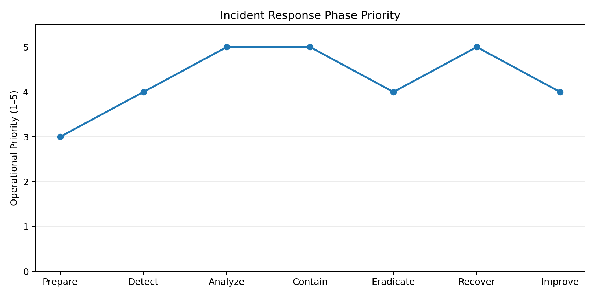
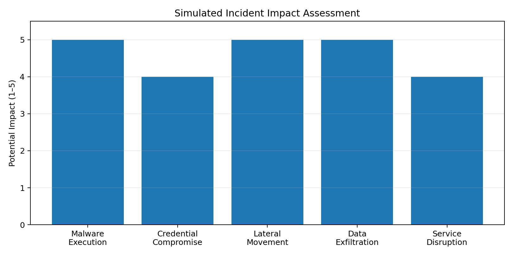

# Week 3 — Incident Response Simulation & Documentation


> A defensive, scenario-based exercise demonstrating incident handling, documentation, and post-incident improvement.

## Executive Summary

This Week 3 assignment models a hypothetical malware and account-compromise scenario. It documents how an organization can prepare for, detect, analyze, contain, eradicate, and recover from a security incident, then use lessons learned to improve its response capability.

The scenario and indicators are simulated for educational purposes. This repository does not claim that a real malware infection or account compromise occurred.

## Contents

- [Objectives](#objectives)
- [Simulation scope](#simulation-scope)
- [Scenario overview](#scenario-overview)
- [Incident response workflow](#incident-response-workflow)
- [Response walkthrough](#response-walkthrough)
- [Evidence and documentation](#evidence-and-documentation)
- [Severity and response metrics](#severity-and-response-metrics)
- [Tools and concepts](#tools-and-concepts)
- [Repository contents](#repository-contents)
- [References](#references)
- [Ethical and legal scope](#ethical-and-legal-scope)

## Objectives

- Demonstrate a structured incident-response lifecycle.
- Describe detection, triage, analysis, and severity classification.
- Develop containment, eradication, and recovery recommendations.
- Explain evidence preservation and incident documentation.
- Identify communication and response roles.
- Define metrics for evaluating response performance.
- Record lessons learned and improvement opportunities.

## Simulation Scope

| Item | Description |
|---|---|
| Exercise type | Hypothetical defensive simulation |
| Scenario | Malware indicator with a related account-compromise concern |
| Initial scope | One employee endpoint and an associated account |
| Stated severity | High |
| Primary concerns | Credential theft, possible lateral movement, data exposure, and service disruption |
| Practical execution | Scenario analysis and response documentation |

## Scenario Overview

The simulated scenario begins when suspicious script execution is observed on an employee endpoint. This is followed by unusual outbound network traffic and an abnormal authentication attempt.

These are scenario indicators for the exercise. They are not presented as forensic evidence collected from a real device or production environment.

| Sequence | Scenario observation | Response question |
|---|---|---|
| 1 | Suspicious script execution on an endpoint | What host, user, process, and time details should be recorded? |
| 2 | Unusual outbound traffic | Which approved telemetry can help establish destination, scope, and context? |
| 3 | Abnormal authentication attempt | Should account sessions, credentials, and authentication logs be reviewed? |

## Incident Response Workflow

**Preparation → Detection → Analysis and Triage → Containment → Eradication → Recovery and Validation → Lessons Learned and Improvement**





## Response Walkthrough

| Stage | Purpose | Defensive activities to consider | Documentation |
|---|---|---|---|
| Preparation | Establish readiness | Define roles, contacts, escalation paths, and approved tooling | Response plan, contact list, asset context |
| Detection | Recognize suspicious activity | Review endpoint, network, and identity alerts | Initial alert details and timestamps |
| Analysis and triage | Understand severity and likely scope | Correlate logs, validate indicators, identify affected assets and accounts | Incident timeline, evidence references, severity rationale |
| Containment | Limit potential impact | Consider endpoint isolation and account/session restrictions under approved procedures | Actions, approvals, timing, and impact |
| Eradication | Remove the underlying cause | Investigate malicious artifacts and address root cause | Findings, cleanup actions, validation evidence |
| Recovery | Restore normal operation safely | Restore from trusted sources, monitor assets, validate access | Recovery checks and monitoring results |
| Improvement | Reduce recurrence and improve readiness | Review lessons learned, control gaps, and response delays | Post-incident review and action owners |

The table describes a recommended response approach for the simulated scenario. It does not claim that these actions were executed on a real environment.

## Evidence and Documentation

A defensible incident record should preserve enough context for another analyst to understand the event and decisions made.

| Field | Purpose |
|---|---|
| Incident identifier | Unique reference for the exercise or case |
| Date and time | Establish a consistent event timeline and timezone |
| Source | Identify the alert, log, or reporting channel |
| Affected asset/account | Record the suspected scope |
| Observation | Describe what was seen without overstating certainty |
| Evidence reference | Point to the preserved log or artifact location |
| Severity rationale | Explain impact and urgency |
| Action and approval | Record containment or recovery decisions |
| Status | Track investigation and remediation progress |

Evidence should be handled according to approved retention, access, and chain-of-custody procedures.

## Severity and Response Metrics

The scenario is classified as **High** severity for this exercise. A real severity decision should use an established rubric considering business impact, affected assets, data sensitivity, scope, and operational disruption.

### Response priorities in this exercise

| Phase | Priority |
|---|---|
| Preparation | Medium |
| Detection | High |
| Analysis | Critical |
| Containment | Critical |
| Eradication | High |
| Recovery | Critical |
| Improvement | High |

### Key response metrics

| Metric | Meaning | Interpretation |
|---|---|---|
| MTTD | Mean Time to Detect | Average time from the defined incident start point to detection |
| MTTC | Mean Time to Contain | Average time to containment; the chosen start point must be stated |
| MTTR | Mean Time to Recover | Average time to restore affected systems or services to an accepted state |

Metric calculations require consistent start/end definitions and timestamped records. This README does not assert measured times or numerical performance results.

Additional review indicators include evidence completeness and incident-exercise success rate.

## Tools and Concepts

The assignment discusses defensive concepts such as:

- SIEM and centralized log review
- Endpoint Detection and Response (EDR)
- Identity and authentication monitoring
- Incident triage and severity classification
- Evidence preservation
- Root-cause analysis
- Incident communication

These are concepts considered in the exercise; this list is not a claim that each platform or product was deployed.

## Repository Contents

```text
week-3-incident-response-simulation/
├── README.md
├── report/
│   └── Week_3_Incident_Response_Simulation_and_Documentation_2026.docx
├── charts/
│   ├── incident-response-priority.png
│   └── incident-impact.png
└── references/
    └── sources.md
```

- **Report:** detailed simulation and documentation.
- **Charts:** incident priority and impact visuals.
- **References:** incident-response guidance used in the assignment.

## References

See [references/sources.md](references/sources.md) for source links, including NIST SP 800-61 Rev. 3, the NIST Incident Response Project, and CISA incident-response guidance.

## Learning Outcomes

- Applying a structured incident-response lifecycle to a scenario.
- Separating observations from assumptions during triage.
- Documenting evidence and decisions clearly.
- Understanding containment, eradication, and recovery priorities.
- Defining incident-response metrics and post-exercise improvements.

## Ethical and Legal Scope

This is an **educational, hypothetical, and defensive simulation**. It does not provide or claim unauthorized access, malware deployment, exploitation, persistence, or investigation of a real victim system. Any real incident handling must follow organizational authorization, privacy, evidence-handling, and escalation procedures.

---

**Author:** Injmam Ansari  
BCA Student | Cyber Security Analyst Intern

*Week 3 internship documentation — Incident Response Simulation & Documentation.*
